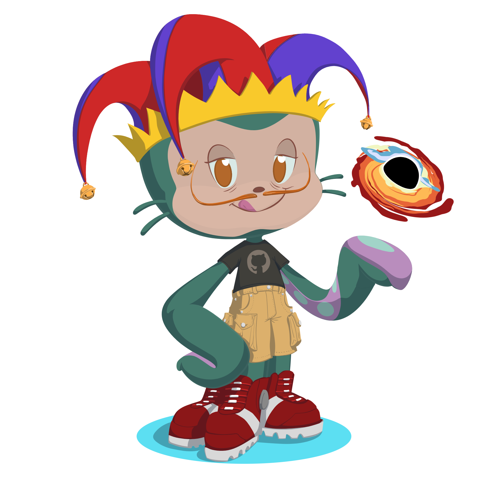

 

<h1 align="center">Hi, I'm Lucas 👋</h1>

 

<table>
  <tr>
    <td width="300">
      
    </td>
    <td>
      

        <strong>Automation and infrastructure engineer</strong> with 3+ years of experience in <strong>Python</strong> and <strong>Bash</strong>, building reliable, traceable solutions for high-volume operations.
      

      

        I connect <strong>REST APIs, databases, web portals, and spreadsheets</strong> into resilient workflows with queuing, retries, logging, and alerting, orchestrated with <strong>Prefect</strong> and <strong>Airflow</strong>. Currently leading the migration of UiPath automations to Python and integrating AI agents via API.
      

      

        Outside of work, I run my own <strong>Ubuntu Server with Docker, Nginx, and Cloudflare Tunnel</strong>, and maintain an <strong>open-source Bash script</strong> that installs a Linux desktop environment on Android through Termux.
      

    </td>
  </tr>
</table>

 

## Key results

- Cut client-reported financial discrepancy cases by **20% per month**
- Eliminated **1.5–2.5 hours of manual work per day** across an operations team

 

## Stack

**Backend** &nbsp;

**Automation** &nbsp;

**Data** &nbsp;

**Infra** &nbsp;

 

## Featured projects

- **[MeuDiario](https://github.com/lucasaguiar-la/MeuDiario)**: full-stack emotion diary web app built with Spring.
- **[Termux Linux GUI](https://github.com/lucasaguiar-la/LinuxAndroid)**: open-source Bash script that installs a Linux desktop environment on Android via Termux.
- **[Sunshine → Moonlight on Fire TV](https://github.com/lucasaguiar-la/SunshineMoonlight)**: guide for streaming from a Windows PC to a Fire TV Stick or even an Android device.

 

## Contact

Feel free to reach out to discuss collaborations, interesting projects, or anything tech-related ;)
